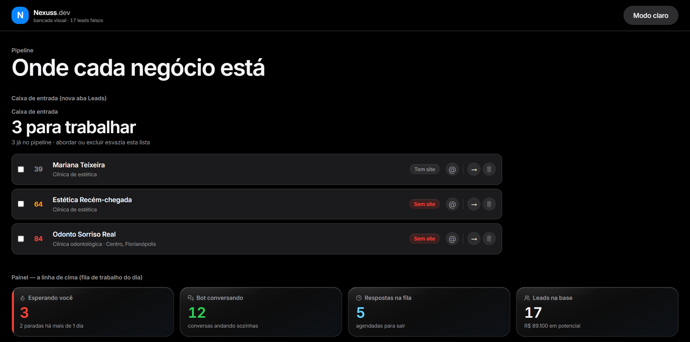
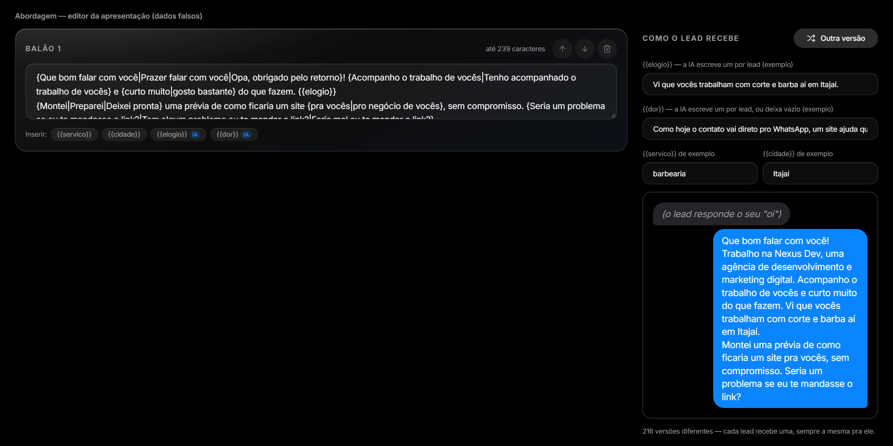
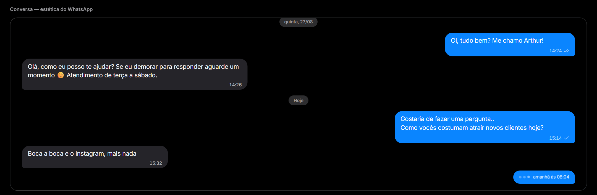
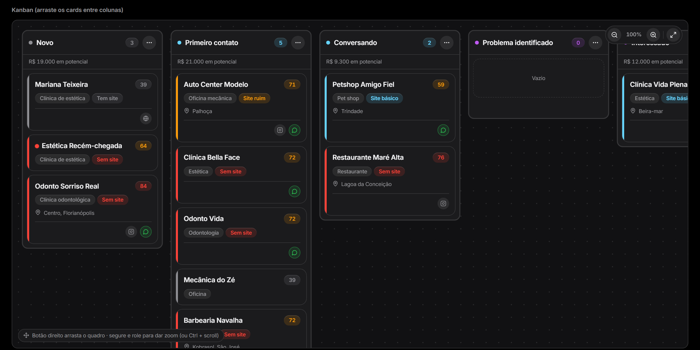
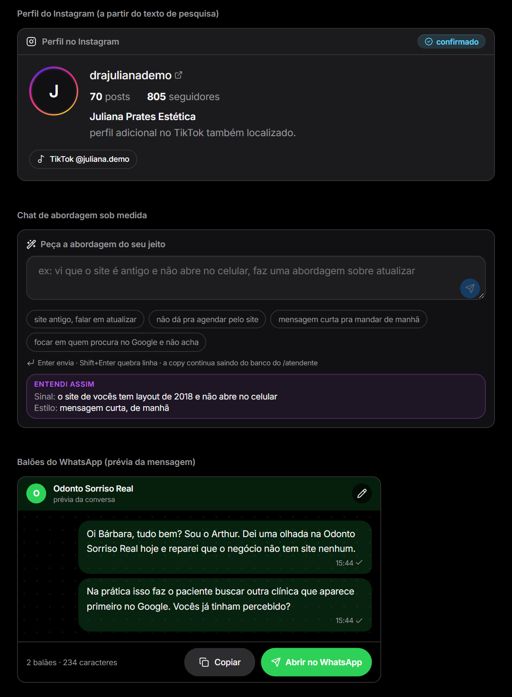
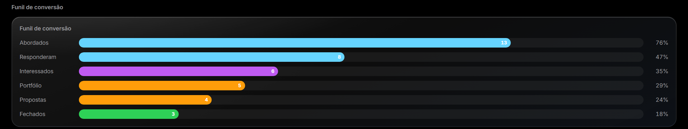
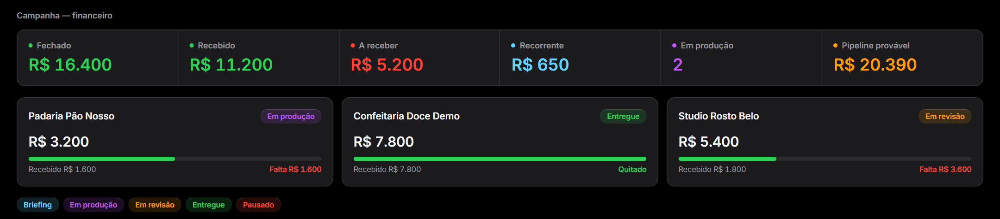
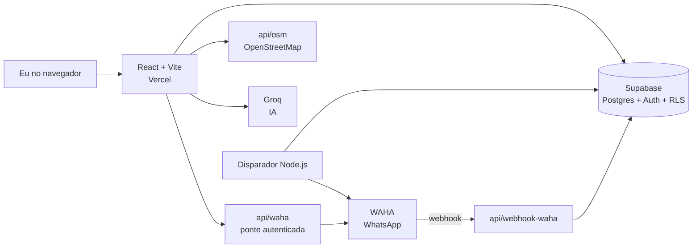

# Nexus CRM — CRM de prospecção com IA

CRM que construí para prospectar meus próprios clientes de criação de sites. Ele encontra negócios
locais sem site, qualifica cada lead, escreve a abordagem com IA, envia pelo WhatsApp em ritmo
humano e organiza a conversa até o contrato fechado.

> Projeto pessoal, em uso real. **Código-fonte privado**: esta página mostra o que ele faz.
> As telas usam dados fictícios. Acesso ao código para avaliação técnica sob solicitação.

## O problema

Prospectar sozinho come o dia: montar lista copiando do mapa, descobrir quem não tem site, escrever
mensagem uma a uma e lembrar quem respondeu. O Nexus junta tudo em um fluxo:
**achar → qualificar → abordar → conversar → fechar**, com a IA no trabalho repetitivo e eu
aprovando o que sai.

## Funcionalidades

- **Captação**: busca de negócios por cidade e nicho no OpenStreetMap (com mapa e score), importação
  por **print do Instagram** com OCR no navegador e importação por CSV
- **Qualificação e score** do lead pela presença digital, e radar de oportunidades
- **Abordagem com IA (Groq)**: editor de mensagem com variações (spintax) e trechos que a IA escreve
  para cada lead, com regras verificadas em teste: uma pergunta só, sem preço, sem emoji, sem jargão
- **WhatsApp (WAHA)**: conversa no estilo do app, central de conversas, triagem automática das respostas
- **Disparo do primeiro contato** com o CRM fechado: janela comercial, intervalos aleatórios, cota
  diária e desligamento automático depois de falhas seguidas
- **Pipeline (kanban)**, funil de conversão, painel do dia e financeiro dos contratos

| Editor de abordagem com IA | Conversa |
|---|---|
|  |  |

| Perfil e chat sob medida | Funil | Financeiro |
|---|---|---|
|  |  |  |

## Arquitetura

- O front não guarda segredo: chaves ficam na conta (protegidas por RLS) ou no servidor.
- O disparador entra **como o usuário**, não com chave de serviço, para a RLS isolar os dados.
- A regra de agenda do disparo é uma função pura, a mesma na tela e no worker.

## Stack

`React` · `Vite` · `Tailwind` · `shadcn/ui` · `TanStack Query` · `Supabase` · `Groq` · `Tesseract (OCR)` ·
`WAHA` · `Leaflet` · `OpenStreetMap` · `Vercel Functions` · `Node.js`

## O que eu aprendi

- Sair de uma plataforma no-code (começou como export do Base44) migrando tela por tela para Supabase.
- IA com regra verificável: testes que barram mensagem genérica antes de ela sair.
- Automação que não vira spam: janela comercial, ritmo humano, cota e freio automático.
- Segurança em app 100% front: o que tem `VITE_` vai para o navegador; segredo fica no servidor.

---

Feito por **Arthur Barreto** — estudante de Ciência da Computação (UFVJM) · [github.com/arthurbarreto07](https://github.com/arthurbarreto07)

© 2026 Arthur Barreto. Todos os direitos reservados.
